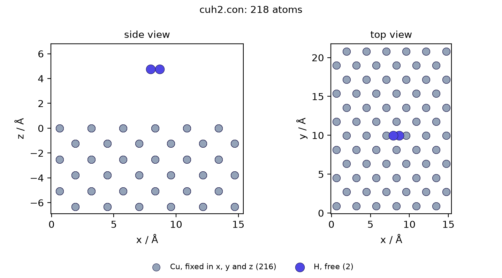

#+title: Tutorial — your first .con checkpoint
#+options: toc:nil num:nil ^:nil
# -*- org-src-preserve-indentation: t; -*-
#+description: One Good Tutorial: Org Babel source; tangled to docs/notebooks/tutorial_core.py and run in CI.
#+PROPERTY: header-args:python :session readcon-core-tut :results output replace :exports code :mkdirp yes

#+begin_export rst
.. note::

   Diátaxis *tutorial* (learning-oriented). **Source of truth is this Org file.**

   CI (``.github/workflows/ci_python.yml``, lean + chemfiles matrices) runs
   ``scripts/run-tutorial-core.sh``: Emacs ``org-babel-tangle`` into
   ``docs/notebooks/tutorial_core.py``, **fails if the committed tangle drifts**,
   then runs that file with ``python3`` against ``resources/test`` fixtures.
   Do not hand-edit the tangled ``.py``; re-tangle with
   ``READCON_TANGLE_UPDATE=1 scripts/run-tutorial-core.sh`` and commit.

   Multi-language recipes: :doc:`howto`. Format conversion: :doc:`chemfiles-tutorial`.
   API tables: :doc:`bindings`. Format rules: :doc:`spec`.
#+end_export

In this tutorial we open a real CON trajectory from the repository fixtures,
inspect cell and =atom_id= data, write a round-trip file, then build a small
checkpoint with total energy.

We use *Python* and the package =readcon= only (no chemfiles, no ASE).
Paths are relative to the repository root. Locally you may =C-c C-c= blocks in
Emacs; **CI does not use session execute as a second path** — it only runs the
tangled =.py= after a drift check so session vs tangle cannot disagree silently.

* What we will do

1. Import =readcon= and locate fixtures under =resources/test/=.
2. Iterate every frame of =tiny_multi_cuh2.con=.
3. Inspect =atom_id= and fixed flags on the first frame.
4. Write a round-trip and confirm the frame count.
5. Build a two-atom frame with total energy and write it.

* Parameters

#+NAME: params
#+begin_src python :tangle ../notebooks/tutorial_core.py
from __future__ import annotations

import os
import sys
from pathlib import Path

# Repo root: CI and local runs cwd to repository root.
REPO = Path(os.environ.get("READCON_TUT_ROOT", Path.cwd())).resolve()
FIXTURES = REPO / "resources" / "test"
MULTI = FIXTURES / "tiny_multi_cuh2.con"
FORCES = FIXTURES / "tiny_cuh2_forces.con"
work_dir = Path(os.environ.get("READCON_TUT_WORK", REPO / "docs" / "notebooks" / "out" / "tutorial_core"))
work_dir.mkdir(parents=True, exist_ok=True)
roundtrip_path = work_dir / "tutorial_roundtrip.con"
built_path = work_dir / "tutorial_built.con"
print("REPO =", REPO)
print("work_dir =", work_dir.resolve())
#+end_src

* Setup

#+NAME: setup
#+begin_src python :tangle ../notebooks/tutorial_core.py
import readcon

print("readcon", getattr(readcon, "__version__", "?"))
print("CON_SPEC_VERSION", readcon.CON_SPEC_VERSION)
assert MULTI.is_file(), f"missing fixture {MULTI}"
assert FORCES.is_file(), f"missing fixture {FORCES}"
#+end_src

With release 0.17.2 this prints:

#+begin_example
readcon 0.17.2
CON_SPEC_VERSION 3
#+end_example

A newer release prints a newer version.
=CON_SPEC_VERSION= is the highest format version the library writes.

* Step 1 — open a multi-frame .con

The fixture =resources/test/tiny_multi_cuh2.con= holds two small Cu/H frames.

#+NAME: step1_iter
#+begin_src python :tangle ../notebooks/tutorial_core.py
n = 0
for frame in readcon.iter_con(str(MULTI)):
    n += 1
    print(n, list(frame.cell), len(frame))

print("frames:", n)
assert n == 2, n
#+end_src

Each line is the frame number, the cell lengths in ångström, and the atom count:

#+begin_example
1 [15.3456, 21.702, 100.0] 4
2 [15.3456, 21.702, 100.0] 4
frames: 2
#+end_example

* Step 2 — inspect identity columns

#+NAME: step2_inspect
#+begin_src python :tangle ../notebooks/tutorial_core.py
frame = readcon.read_first_frame(str(MULTI))
print("spec_version:", frame.spec_version)
# energy is a property (None when JSON omits it), not a method
print("energy:", frame.energy)
for atom in list(frame.atoms)[:2]:
    print(
        atom.symbol,
        round(atom.x, 4),
        round(atom.y, 4),
        round(atom.z, 4),
        "fixed=",
        atom.is_fixed,
        "atom_id=",
        atom.atom_id,
    )
assert frame.spec_version >= 2
assert frame.energy is None
assert list(frame.atoms)[0].symbol == "Cu"
assert list(frame.atoms)[0].atom_id == 0
assert list(frame.atoms)[0].is_fixed is True
#+end_src

#+begin_example
spec_version: 2
energy: None
Cu 0.6394 0.9045 6.9753 fixed= True atom_id= 0
Cu 3.1969 0.9045 6.9753 fixed= True atom_id= 1
#+end_example

This file was written with format version 2 and stores no energy.
Look at =atom_id=: column 5 of the coordinate block.
It is the index the atom had before the file grouped atoms by element.
Nudged elastic band (NEB) and dimer tools use that index to match atoms across files.
Fixed flags come from column 4.

** The copper slab

To see what the fixed flags are for, read a larger fixture, a copper slab with two hydrogen atoms above it:

#+NAME: step2_slab
#+begin_src python :tangle ../notebooks/tutorial_core.py
slab = readcon.read_first_frame(str(FIXTURES / "cuh2.con"))
fixed = [a for a in slab.atoms if all(a.fixed)]
free = [a for a in slab.atoms if not any(a.fixed)]
print("atoms:", len(slab), "fixed:", len(fixed), "free:", len(free))
print("free symbols:", sorted({a.symbol for a in free}))
assert (len(slab), len(fixed), len(free)) == (218, 216, 2)
#+end_src

#+begin_example
atoms: 218 fixed: 216 free: 2
free symbols: ['H']
#+end_example

All 216 copper atoms are fixed in x, y and z, so a code that honours the flags moves only the two hydrogen atoms.
The script =docs/orgmode/img/tutorial_slab.py= draws this file:

#+CAPTION: =resources/test/cuh2.con= as read by readcon. Grey: copper, fixed in all three directions. Blue: hydrogen, free.
#+ATTR_RST: :alt Side and top views of a six-layer copper slab with two hydrogen atoms above its surface

* Step 3 — write a round-trip

#+NAME: step3_roundtrip
#+begin_src python :tangle ../notebooks/tutorial_core.py
frames = readcon.read_con(str(MULTI))
readcon.write_con(str(roundtrip_path), frames)
again = list(readcon.iter_con(str(roundtrip_path)))
print("wrote", len(frames), "frames; reread", len(again))
assert len(again) == len(frames) == 2
assert len(again[0]) == 4
#+end_src

#+begin_example
wrote 2 frames; reread 2
#+end_example

The written file is under =docs/notebooks/out/tutorial_core/=.

* Step 4 — build a checkpoint with energy

Read a forces-bearing fixture, then build a tiny frame of your own:

#+NAME: step4_build
#+begin_src python :tangle ../notebooks/tutorial_core.py
ref = readcon.read_first_frame(str(FORCES))
print("has_forces:", ref.has_forces, "energy:", ref.energy)
assert ref.has_forces is True
assert ref.energy == -42.5

atoms = [
    readcon.Atom("Cu", 0.0, 0.0, 0.0, atom_id=0, mass=63.546),
    readcon.Atom("H", 1.5, 0.0, 0.0, atom_id=1, mass=1.008),
]
frame = readcon.ConFrame(
    cell=[10.0, 10.0, 10.0],
    angles=[90.0, 90.0, 90.0],
    atoms=atoms,
    prebox_header=["tutorial checkpoint", ""],
)
frame.set_energy(-1.25)
frame.write_con(str(built_path))

check = readcon.read_first_frame(str(built_path))
print("built atoms:", len(check), "energy:", check.energy)
assert len(check) == 2
assert check.energy == -1.25
#+end_src

#+begin_example
has_forces: True energy: -42.5
built atoms: 2 energy: -1.25
#+end_example

This is the whole of =tutorial_built.con=:

#+begin_example
tutorial checkpoint
{"con_spec_minor":1,"con_spec_version":3,"energy":-1.25,"units":{"energy":"eV","length":"angstrom","mass":"amu"}}
10.0 10.0 10.0
90.0 90.0 90.0

2
1 1
63.546 1.008
Cu
Coordinates of Component 1
0.0 0.0 0.0 0 0
H
Coordinates of Component 2
1.5 0.0 0.0 0 1
#+end_example

Line 1 is the comment you passed as =prebox_header=.
Line 2 holds the energy you set as JSON (JavaScript Object Notation), along with the format version and units.
Lines 3 and 4 are the cell lengths and angles.
Lines 7 to 9 give the number of element types, the atoms of each type, and their masses.
Each coordinate row is =x y z fixed atom_id=.

* Checkpoint

#+NAME: checkpoint
#+begin_src python :tangle ../notebooks/tutorial_core.py
import json

summary = {
    "multi_frames": 2,
    "roundtrip": str(roundtrip_path.resolve()),
    "built": str(built_path.resolve()),
    "built_energy": check.energy,
    "has_forces_fixture": bool(ref.has_forces),
}
(work_dir / "summary.json").write_text(
    json.dumps(summary, indent=2) + "\n", encoding="utf-8"
)
print(json.dumps(summary, indent=2))
print("OK — org-mode CON checkpoint tutorial finished", file=sys.stderr)
#+end_src

You now:

- install and import =readcon=
- iterate and materialize multi-frame CON
- read =atom_id= and fixed flags
- write round-trips
- construct a frame with metadata energy

* Run from the shell

#+begin_export rst
.. code-block:: shell

   # after: maturin develop --features python  (or pip install readcon)
   scripts/run-tutorial-core.sh
#+end_export

Emacs: open this file and =C-c C-c= each Python block for interactive use.
CI and =scripts/run-tutorial-core.sh= re-tangle, refuse drift, and run
=docs/notebooks/tutorial_core.py= only — do not hand-edit the tangled =.py=.

* Next steps

| Need | Page |
|------+------|
| Same tasks in Rust / C / C++ / Julia / Fortran | [[file:howto.org][howto]] |
| XYZ / PDB / GRO → CON (Babel + CI) | [[file:chemfiles-tutorial.org][chemfiles-tutorial]] / [[file:chemfiles-notebook.org][chemfiles-notebook]] |
| Declared sections (=forces=, =charges=, …) | [[file:faq.org][faq]], [[file:spec.org][spec]] |
| Full API tables | [[file:bindings.org][bindings]] |
